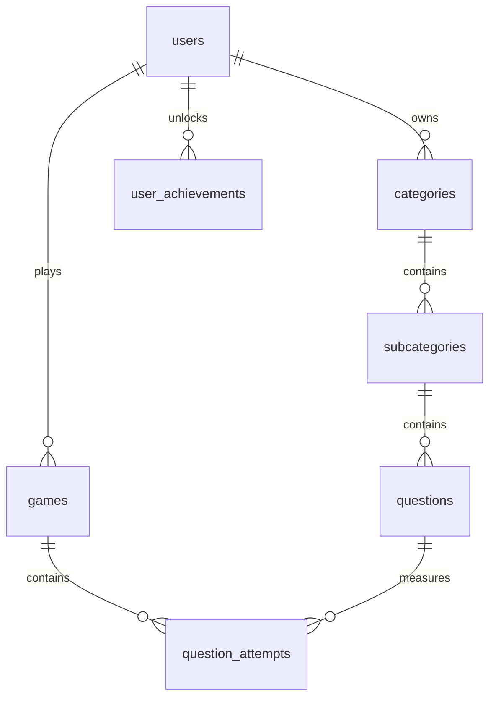

# Auditoría final de migración de datos

Fecha: 3 de noviembre de 2026.

## Resultado MySQL

| Entidad | Registros |
|---|---:|
| users | 3 |
| categories | 8 |
| subcategories | 28 |
| questions | 420 |
| games | 0 |
| question_attempts | 0 |

Roles activos: un `admin` y dos `estudiante`. Las cuentas demo de profesor y estudiante se retiraron porque no tenían datos relacionados. El administrador conserva el username `admin`, usa `administrador@jmenachop.com` y debe completar verificación y recuperación por correo.

No existen tablas o columnas temporales de importación. No existen roles inválidos, correos duplicados ni relaciones huérfanas.

## Relaciones finales

## Seguridad y despliegue

- Todas las contraseñas activas usan el hasher de Laravel.
- Las credenciales demostrativas fueron retiradas de los archivos actuales y rotadas o eliminadas en MySQL.
- El backend Node se conserva solo como referencia local y queda fuera del paquete de cPanel.
- El respaldo previo y el dump final están en `storage/backups/`, carpeta excluida de Git por contener datos privados.
- Producción debe importar el dump final y apuntar el document root a `backend-laravel/public`.
